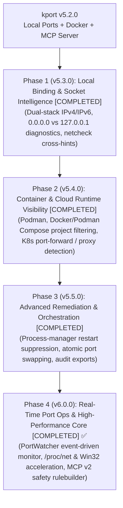

# 🗺️ kport Strategic Roadmap: Host & Container Port Operations

> **Status:** Approved Strategy & Architecture  
> **Product Identity:** Host & Container Port/Process Operations  
> **Companion Tool:** [netcheck](https://github.com/farman20ali/netcheck) (Network Intelligence & Diagnostic Scanner)  
> **Target Version Horizon:** v5.3.0 – v6.0.0  
> **License:** Apache 2.0

---

## 1. Executive Summary & Strategic Positioning

### The Core Problem: Feature Creep vs. Tool Mastery
When building developer utilities, a common pitfall is attempting to make a single tool do everything. If `kport` were expanded into a general-purpose network scanner (host discovery, CIDR sweeps, Nmap clones), it would suffer from:
1. **Self-Cannibalization:** Duplicating capabilities already built in its companion tool, **[`netcheck`](https://github.com/farman20ali/netcheck)** (which already specializes in `tcp`, `dns`, `http`, `ssl`, `ping`, and interfaces).
2. **Loss of Focus:** `kport`'s core strength is local process attribution, container runtime awareness, and safe, reliable port conflict remediation. Bloating it with external network scanning dilutes its speed and ergonomics.

### The Two-Tool Strategy: Separation of Concerns

```
┌────────────────────────────────────────────────────────┐
│                   AlienHub DevSuite                    │
└───────────┬────────────────────────────────┬───────────┘
            │                                │
            ▼                                ▼
┌────────────────────────────────┐   ┌────────────────────────────────┐
│             kport              │   │            netcheck            │
│   Host & Process Operations    │   │      Network Intelligence      │
├────────────────────────────────┤   ├────────────────────────────────┤
│ • "Inside-Out" view            │   │ • "Outside-In" view            │
│ • Local port & socket ownership│   │ • Subnet & CIDR discovery      │
│ • PID, PPID, cgroup tracking   │   │ • Remote port reachability     │
│ • Docker / Podman / K8s proxy  │   │ • HTTP, SSL, TLS inspection    │
│ • Safe process tree kill       │   │ • Ping latency & jitter        │
│ • Watch mode & Port holding    │   │ • Nmap-style service probing   │
│ • Local MCP remediation tools  │   │ • Network MCP diagnostic tools │
└────────────────────────────────┘   └────────────────────────────────┘
```

> **The Architectural Rule:**  
> If an action involves **inspecting, terminating, or managing local processes, sockets, or containers on this machine**, it belongs in **`kport`**.  
> If an action involves **probing remote hosts, scanning subnets, checking SSL/DNS, or network topology**, it belongs in **`netcheck`**.

---

## 2. Cross-Tool Synergy: How kport & netcheck Complement Each Other

Rather than bundling everything into one binary, `kport` and `netcheck` form a cohesive developer workflow:

### 2.1 The Diagnostic Handshake
When developers or AI agents debug a failed connection, both views are required:

```
[Developer / AI Agent]
         │
         ├── 1. Outside-In: Run `netcheck tcp 192.168.1.10:8080`
         │      ↳ Result: ECONNREFUSED
         │      ↳ netcheck Hint: "Port closed or bound to loopback only. On the target host, run 'kport diagnose 8080'."
         │
         └── 2. Inside-Out: Run `kport diagnose 8080` (on target machine)
                ↳ Result: Found process 'uvicorn' listening on 127.0.0.1:8080 (not 0.0.0.0)
                ↳ kport Hint: "Process is bound to localhost only. Rebind to 0.0.0.0, then verify with 'netcheck tcp <ip>:8080'."
```

### 2.2 Complementary MCP Toolsets for AI Coding Agents
AI coding agents (in Cursor, Claude, Antigravity, Copilot) load both MCP servers:
* **`kport-mcp`**: Provides local host action tools (`list_ports`, `inspect_port`, `kill_port`, `stop_service`, `detect_conflicts`).
* **`netcheck-mcp`**: Provides network discovery tools (`check_tcp`, `check_dns`, `check_http`, `check_ssl`, `ping_host`).

---

## 3. kport Strategic Roadmap (v5.3.0 – v6.0.0)

With network scanning cleanly designated to `netcheck`, `kport` focuses entirely on becoming the undisputed leader in **host, container, and runtime port operations**.



---

### Phase 1 — Local Binding Intelligence & Diagnostics (v5.3.0) ✅ [COMPLETED]
**Theme:** *Explain why local sockets behave unexpectedly before taking action.*

#### Objectives
1. [x] **Binding Scope Analysis:**
   - Detect whether a listening socket is bound to `127.0.0.1` (loopback only), `0.0.0.0` (all IPv4 interfaces), `::1`, or `::` (dual-stack IPv6).
   - Flag "Loopback Leak" risks: when a dev server intended for LAN/Docker access is trapped on localhost.
   - Include direct `netcheck` cross-tool recommendations in `kport diagnose` and `kport explain`.

2. [x] **Dual-Stack & IPv6 Shadowing:**
   - Detect when an IPv6 listener (`:::8080`) is intercepting or blocking IPv4 requests due to OS `IPV6_V6ONLY` socket flags.

3. [x] **Stale & Zombie Socket State Detection:**
   - Identify sockets lingering in `TIME_WAIT`, `CLOSE_WAIT`, or `FIN_WAIT_2` states without active process owners.
   - Advise the user on kernel socket reuse flags (`SO_REUSEADDR`) or safe reclamation.

#### CLI & Output Enhancements
```bash
$ kport diagnose 8080

┌─ OBSERVATION ────────────────────────────────────────────────────────┐
│ Port: 8080/tcp | State: LISTEN | Bind: 127.0.0.1:8080 (Loopback only)│
│ Process: node (PID 14208) | Parent: npm (PID 14190)                  │
├─ INFERENCE ──────────────────────────────────────────────────────────┤
│ Service is running locally but UNREACHABLE by external containers or │
│ network peers because it is not bound to 0.0.0.0.                     │
├─ COMPANION TOOL HINT ────────────────────────────────────────────────┤
│ To verify remote connectivity from another machine or container, run:│
│   netcheck tcp <ip>:8080                                             │
├─ RECOMMENDATION ─────────────────────────────────────────────────────┤
│ 1. Configure server host to '0.0.0.0' in your application settings.   │
│ 2. If freeing this port is desired, run: kport kill 8080             │
└──────────────────────────────────────────────────────────────────────┘
```

---

### Phase 2 — Container & Cloud Runtime Visibility (v5.4.0) ✅ [COMPLETED]
**Theme:** *Bridge the gap between host processes, container engines, and local cloud proxies.*

#### Objectives
1. [x] **Podman & Rootless Container Support:**
   - Extended `docker_engine.py` into a unified `container_engine.py` supporting both Docker and rootless Podman runtimes.
   - Retained complete backward compatibility via transparent alias and delegation in `docker_engine.py`.
2. [x] **Docker & Podman Compose Project Awareness:**
   - Detect Compose project names, service names (`web`, `redis`, `api`), and container networks from labels (`com.docker.compose.*`, `io.podman.compose.*`).
   - Added CLI filtering: `kport list --compose-project <name> --compose-service <svc>`, `kport docker --compose-project ...`.
3. [x] **Kubernetes Port-Forward & Proxy Detection:**
   - Created `k8s_detector.py` detecting `kubectl port-forward`, `oc port-forward`, `minikube tunnel/service`, `kind`, and `telepresence`.
   - Formatted process names with target resource and namespace: e.g. `kubectl (port-forward -> svc/billing-api:80, ns: prod)`.
   - Added `k8s_port_forward` diagnosis inferences and `stop_k8s_proxy` recommendations in `kport diagnose` and `kport explain`.

---

### Phase 3 — Advanced Remediation & Process Manager Coordination (v5.5.0) ✅ [COMPLETED]
**Theme:** *Fix port conflicts cleanly without breaking developer workflows.*

#### Objectives
1. [x] **Process Manager Restart Suppression:**
   - Implemented `kport kill --service-aware` to detect managing supervisors (`systemd`, `pm2`, `supervisor`, `windows-service`) and issue graceful stop commands (`systemctl stop`, `pm2 stop`, `Stop-Service`) instead of triggering infinite supervisor restart loops.
2. [x] **Atomic Port Reservation & Handover (`kport swap`):**
   - Implemented `kport swap <port> [--command <cmd>] [--timeout <sec>]`: cleanly frees the port, atomically binds an exclusive holding socket (`SO_EXCLUSIVEADDRUSE`), and performs zero-race handover directly to the user application or holds until keypress.
3. [x] **Audit Compliance & CI/CD Telemetry:**
   - Extended `kport audit` with `--format=[table|json|ndjson|siem]` and `--export <file>` for enterprise CI/CD and SIEM telemetry (Common Event Format / CEF).

---

### Phase 4 — High-Performance Core & Real-Time Port Ops (v6.0.0) ✅ [COMPLETED]
**Theme:** *Instantaneous response times, live event streams, and zero-overhead AI execution.*

#### Objectives
1. [x] **Event-Driven Port Watcher (`kport/watcher.py`):**
   - `PortWatcher` class with background thread, `on_event` callback, `poll()` / `drain_events()` API.
   - `watch_ports()` convenience generator for simple iteration.
   - `kport watch` (no port specified) → global all-ports event-driven mode using `PortWatcher`.
   - `kport watcher-info` command shows platform-specific strategy details.
2. [x] **High-Performance Inspection Acceleration:**
   - Linux: Direct `/proc/net/tcp`, `/proc/net/tcp6`, `/proc/net/udp` parsing via `fast_list_listening_linux()` — sub-millisecond scan with no process-table overhead.
   - Windows: `GetExtendedTcpTable` Win32 API via ctypes in `fast_list_listening_windows()` — zero subprocess overhead.
   - `watcher_platform_info()` reports active strategy per platform.
3. [x] **Model Context Protocol (MCP) v2 — Safety Shield Rulebuilder (`kport/mcp_rules.py`):**
   - `McpRule` / `RuleSet` dataclasses with first-match rule evaluation engine.
   - Per-agent identity controls, action allow/deny lists, port ranges, PID scopes.
   - Three built-in presets: `dev` (permissive), `ci` (ephemeral ports only), `enterprise` (deny-by-default with trusted-agent allowlist).
   - JSON persistence at `~/.kport/mcp_rules.json` (env-overridable via `KPORT_MCP_RULES`).
   - Four new MCP tools: `get_safety_rules`, `set_safety_rules`, `watch_ports_snapshot`, `watcher_info`.

---

## 4. Codebase Architecture Alignment

Here is how the planned evolution maps cleanly into the existing `kport` codebase:

```
src/kport/
├── cli.py                     # CLI router & arguments
├── cli_commands.py            # Command handlers (diagnose, inspect, kill, watch, hold)
├── diagnostics.py             # 4-part diagnosis: add loopback, IPv6, and stale socket logic
├── container_engine.py        # [EVOLVED from docker_engine.py] Docker + Podman + Compose
├── process_manager.py         # Systemd, PM2, Supervisord auto-restart prevention
├── safety.py                  # Safety shields & blast-radius protection
├── constants.py               # Protected ports, process names, and system services
├── inspectors/
│   ├── base.py                # BaseInspector interface
│   ├── system_impl.py         # Cross-platform CLI fallback (lsof, ss, netstat)
│   └── psutil_impl.py         # Fast kernel API inspector
└── mcp_server.py              # Zero-dependency stdio MCP server for AI agents
```

---

## 5. Summary: Why This Strategy Wins

| Attribute | Bloated Approach (kport doing Nmap) | Recommended Strategy (kport + netcheck) |
| :--- | :--- | :--- |
| **Code Quality** | Complex, huge dependency tree, high bug rate | Clean, focused, easily tested components |
| **Performance** | Slow startup, heavy scanning overhead | Blazing fast CLI execution (<50ms) |
| **Product Identity** | Confusing (Is it a port killer or a scanner?) | Crystal clear (kport = Host Ops, netcheck = Network Intel) |
| **Maintenance** | Duplicated code across two personal repos | Independent release cycles, shared ecosystem |
| **Developer UX** | Cluttered flags and conflicting subcommands | Elegant Unix-style composability |
